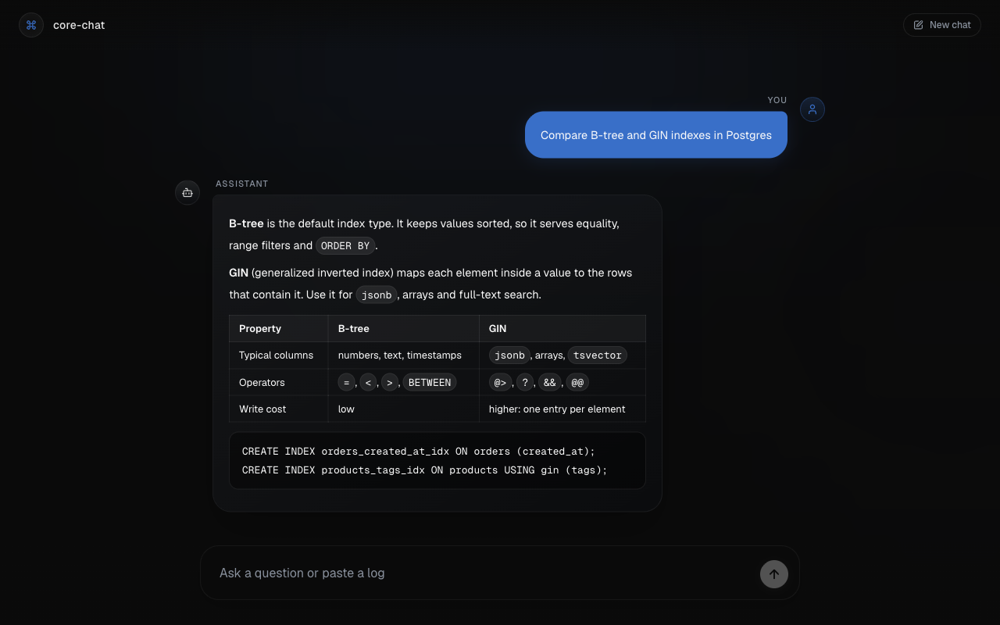
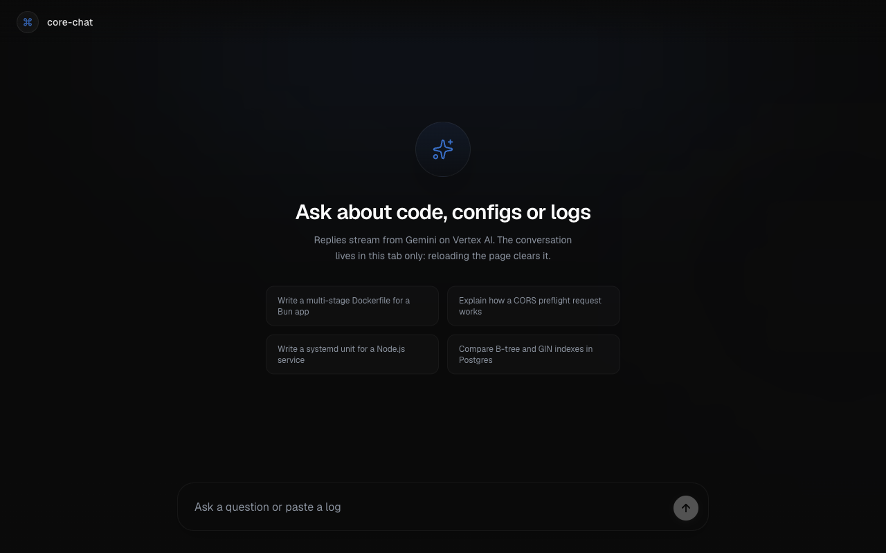
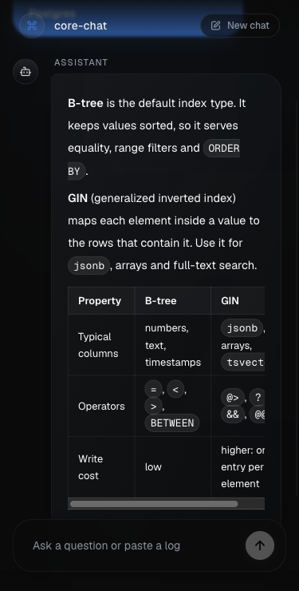
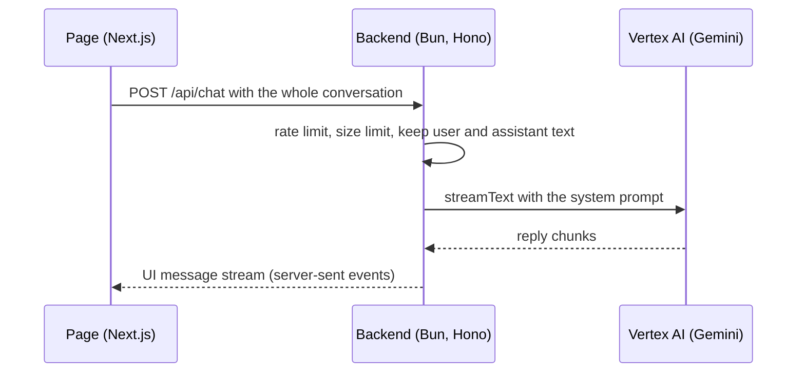

# core-chat

[Polski](README.pl.md)

A small chat app. A Next.js page sends the conversation to a Bun and Hono backend. The backend streams the reply from Gemini on Google Vertex AI back to the page.



The reply in the screenshots comes from the stand-in model that the backend tests use (`MockLanguageModelV3` from the AI SDK), because they were taken without a Vertex AI key. The reply text is scripted. The page, the backend and the stream between them are the real code.

| Empty state, 1280 px | Phone, 375 px |
|---|---|
|  |  |

## What works

- Replies stream token by token and render as Markdown, with tables and code blocks.
- You can stop a reply, retry a failed one and start a new chat.
- A failed request shows a plain message on the page. The backend writes the details to its own log and never sends them to the browser.
- The backend checks every request before it calls the model (limits are constants in `backend/app.ts`):
  - at most 10 requests per minute per client address (HTTP 429 with `Retry-After`);
  - at most 256 KB of JSON per request (HTTP 413);
  - only user and assistant text reaches the model, so a client cannot replace the system prompt or send file URLs;
  - only the origins in `ALLOWED_ORIGINS` pass CORS.
- 13 backend tests run against the real Hono app with a stand-in model. CI runs them, both linters (oxlint for the backend, ESLint for the frontend), both type checks and the Next.js build.

## Not done yet

- No authentication. Anyone who can reach the backend can spend your Vertex AI quota. The rate limit and the size limit slow this down; they do not stop it. So the backend listens on 127.0.0.1 only, unless you set `HOST`. Add authentication before you expose it.
- No saved history. The conversation lives in the browser tab. Reloading the page clears it.
- API key only. The backend uses Vertex AI express mode, which calls the global endpoint. There is no service-account login and no way to keep requests in one region.
- Preview model. The model is `gemini-3.1-flash-lite-preview` (set in `backend/index.ts`). Google can retire preview models.
- One process. The rate limit lives in memory. Behind a reverse proxy every client has the proxy's address, so the limit becomes one shared limit.
- Docker for the backend only. There is no frontend image and no Compose file. CI builds the image on every run.

## How it works



The page uses `useChat` from the AI SDK. It sends the whole conversation with every message, so the backend keeps no state.

## Run it locally

You need [Bun](https://bun.sh) 1.4, Node.js 20.9 or newer (Next.js runs on Node) and a Vertex AI API key.

```sh
git clone https://github.com/NetBr3ak/core-chat.git
cd core-chat
cp .env.example .env        # put your key in GOOGLE_VERTEX_API_KEY

cd backend
bun install
bun run dev                 # http://localhost:3001, reads ../.env
```

In a second terminal:

```sh
cd frontend
bun install
bun run dev                 # http://localhost:3000
```

Without a key, the backend stops at start and says which variable is missing. With a wrong key, the page shows "The model request failed" and the backend log shows the error from Vertex AI.

The page calls `http://localhost:3001` by default. To use another backend address, set `NEXT_PUBLIC_API_URL` in `frontend/.env.local` or in the environment before `bun run build`. Next.js puts the value into the page at build time.

## Run the backend in Docker

```sh
docker build -t core-chat-backend backend
docker run --rm -p 127.0.0.1:3001:3001 --env-file .env core-chat-backend
```

The image sets `HOST=0.0.0.0`, because Docker forwards the port from outside the container. `-p 127.0.0.1:3001:3001` publishes the port on this computer only. The image runs as the unprivileged `bun` user. Then start the frontend as above.

## Checks

From the repository root:

```sh
(cd backend && bun run lint && bun run typecheck && bun test)
(cd frontend && bun run lint && bun run typecheck && bun run build)
```

## API

| Route | Answer |
|---|---|
| `GET /health` | `{"status":"ok","uptime":<seconds>}` |
| `POST /api/chat` | Body `{"messages": UIMessage[]}`. Returns an AI SDK UI message stream. Errors are plain text: 400, 413, 429. |

## Project layout

```text
backend/    app.ts (routes, limits, system prompt), index.ts (settings, server start), app.test.ts
frontend/   Next.js App Router page in src/app, chat components in src/components/chat
docs/       screenshots
```

## Credits

- Fonts: Geist and Geist Mono (Vercel) and Inter (Rasmus Andersson), all under the SIL Open Font License 1.1, loaded with `next/font`.
- Icons: [Lucide](https://lucide.dev) (ISC license; the parts Lucide derived from Feather are under the MIT license).
- App icon: `frontend/src/app/icon.svg` uses the Lucide `command` path, which Lucide derived from Feather. The file carries the full Lucide license text.
- The project started as a January 2026 prototype by Domson (React Router with a Postgres history store). The current code replaced it in March 2026.

## License

MIT, see [LICENSE](LICENSE).
