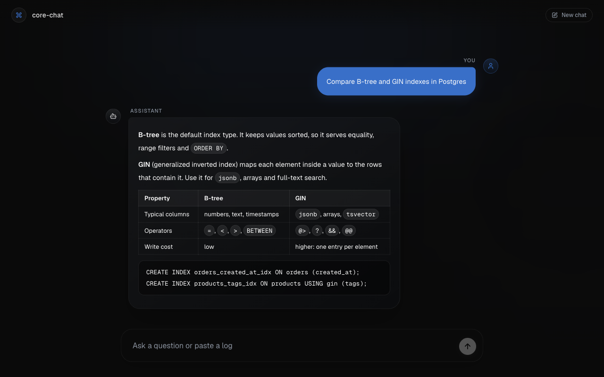
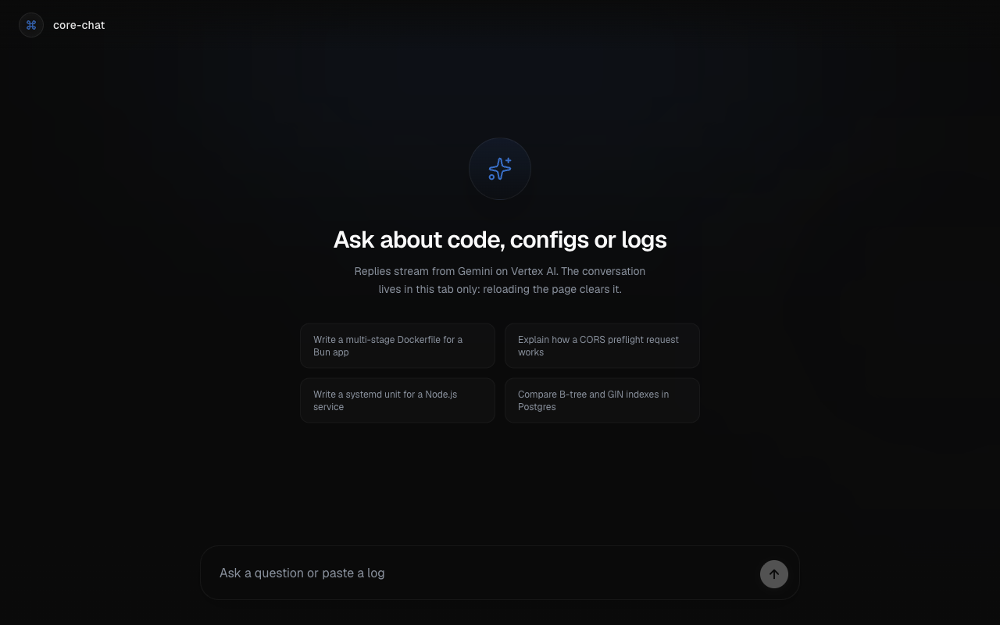
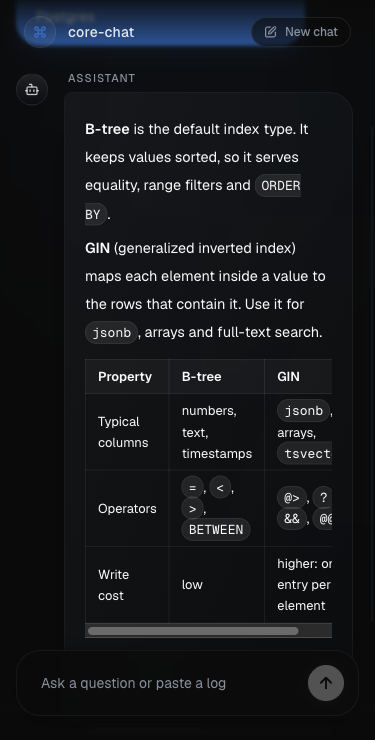
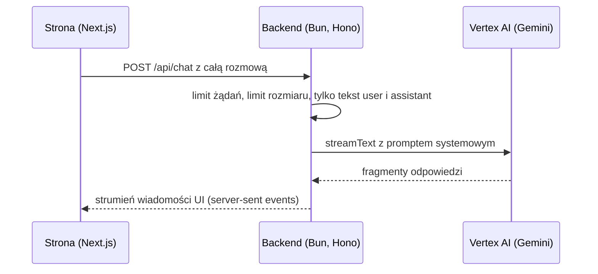

# core-chat

[English](README.md)

Mała aplikacja czatu. Strona w Next.js wysyła rozmowę do backendu w Bun i Hono. Backend strumieniuje odpowiedź modelu Gemini z Google Vertex AI z powrotem na stronę.



Odpowiedź na zrzutach pochodzi z modelu zastępczego, którego używają testy backendu (`MockLanguageModelV3` z AI SDK), bo zrzuty powstały bez klucza Vertex AI. Tekst odpowiedzi jest z góry napisany. Strona, backend i strumień między nimi to prawdziwy kod.

| Pusty ekran, 1280 px | Telefon, 375 px |
|---|---|
|  |  |

## Co działa

- Odpowiedź przychodzi fragment po fragmencie i wyświetla się jako Markdown, z tabelami i blokami kodu.
- Odpowiedź można zatrzymać, nieudaną ponowić, a rozmowę zacząć od nowa.
- Nieudane żądanie pokazuje na stronie prosty komunikat. Szczegóły backend zapisuje we własnym logu i nigdy nie wysyła ich do przeglądarki.
- Backend sprawdza każde żądanie, zanim wywoła model (limity to stałe w `backend/app.ts`):
  - najwyżej 10 żądań na minutę z jednego adresu klienta (HTTP 429 z `Retry-After`);
  - najwyżej 256 KB JSON w jednym żądaniu (HTTP 413);
  - do modelu trafia tylko tekst użytkownika i asystenta, więc klient nie podmieni promptu systemowego i nie wyśle adresu pliku;
  - CORS przepuszcza tylko adresy z `ALLOWED_ORIGINS`.
- 13 testów backendu działa na prawdziwej aplikacji Hono z modelem zastępczym. CI uruchamia je, oba lintery (oxlint dla backendu, ESLint dla frontendu), oba sprawdzenia typów i build Next.js.

## Czego jeszcze nie ma

- Brak logowania. Każdy, kto dotrze do backendu, zużywa Twój limit Vertex AI. Limit żądań i limit rozmiaru to spowalniają, ale nie blokują. Dlatego backend nasłuchuje tylko na 127.0.0.1, chyba że ustawisz `HOST`. Dodaj logowanie, zanim go wystawisz.
- Brak zapisanej historii. Rozmowa żyje w karcie przeglądarki. Odświeżenie strony ją czyści.
- Tylko klucz API. Backend używa trybu express Vertex AI, który woła globalny endpoint. Nie ma logowania kontem usługi ani sposobu, by trzymać żądania w jednym regionie.
- Model w wersji preview. Model to `gemini-3.1-flash-lite-preview` (ustawiony w `backend/index.ts`). Google może wycofać modele preview.
- Jeden proces. Limit żądań jest w pamięci. Za reverse proxy każdy klient ma adres proxy, więc limit staje się jednym wspólnym limitem.
- Docker tylko dla backendu. Nie ma obrazu frontendu ani pliku Compose. CI buduje obraz przy każdym przebiegu.

## Jak to działa



Strona używa `useChat` z AI SDK. Przy każdej wiadomości wysyła całą rozmowę, więc backend nie przechowuje stanu.

## Uruchomienie lokalne

Potrzebujesz [Bun](https://bun.sh) 1.4, Node.js 20.9 lub nowszego (Next.js działa na Node) i klucza API Vertex AI.

```sh
git clone https://github.com/NetBr3ak/core-chat.git
cd core-chat
cp .env.example .env        # wpisz klucz w GOOGLE_VERTEX_API_KEY

cd backend
bun install
bun run dev                 # http://localhost:3001, czyta ../.env
```

W drugim terminalu:

```sh
cd frontend
bun install
bun run dev                 # http://localhost:3000
```

Bez klucza backend zatrzymuje się przy starcie i podaje brakującą zmienną. Ze złym kluczem strona pokazuje "The model request failed", a log backendu pokazuje błąd z Vertex AI.

Strona domyślnie woła `http://localhost:3001`. Inny adres backendu ustaw w `NEXT_PUBLIC_API_URL` w `frontend/.env.local` albo w środowisku przed `bun run build`. Next.js wpisuje tę wartość do strony podczas budowania.

## Backend w Dockerze

```sh
docker build -t core-chat-backend backend
docker run --rm -p 127.0.0.1:3001:3001 --env-file .env core-chat-backend
```

Obraz ustawia `HOST=0.0.0.0`, bo Docker przekazuje port spoza kontenera. `-p 127.0.0.1:3001:3001` udostępnia port tylko na tym komputerze. Obraz działa jako użytkownik `bun` bez uprawnień roota. Frontend uruchom jak wyżej.

## Sprawdzenia

Z katalogu głównego repozytorium:

```sh
(cd backend && bun run lint && bun run typecheck && bun test)
(cd frontend && bun run lint && bun run typecheck && bun run build)
```

## API

| Ścieżka | Odpowiedź |
|---|---|
| `GET /health` | `{"status":"ok","uptime":<sekundy>}` |
| `POST /api/chat` | Treść `{"messages": UIMessage[]}`. Zwraca strumień wiadomości UI z AI SDK. Błędy to zwykły tekst: 400, 413, 429. |

## Układ projektu

```text
backend/    app.ts (ścieżki, limity, prompt systemowy), index.ts (ustawienia, start serwera), app.test.ts
frontend/   strona Next.js App Router w src/app, komponenty czatu w src/components/chat
docs/       zrzuty ekranu
```

## Zasoby i autorzy

- Fonty: Geist i Geist Mono (Vercel) oraz Inter (Rasmus Andersson), wszystkie na licencji SIL Open Font License 1.1, ładowane przez `next/font`.
- Ikony: [Lucide](https://lucide.dev) (licencja ISC; części, które Lucide przejął z Feather, są na licencji MIT).
- Ikona aplikacji: `frontend/src/app/icon.svg` używa ścieżki `command` z Lucide, którą Lucide przejął z Feather. Plik zawiera pełny tekst licencji Lucide.
- Projekt zaczął się od prototypu Domsona ze stycznia 2026 (React Router z historią rozmów w Postgres). Obecny kod zastąpił go w marcu 2026.

## Licencja

MIT, zobacz [LICENSE](LICENSE).
